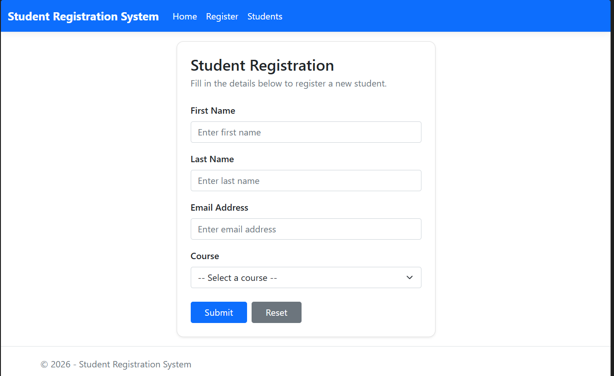

# 🎓 Student Registration System

### 🚀 A Simple and Efficient Student Registration Web Application

A web-based **Student Registration System** built using **ASP.NET Core MVC (.NET 8), C#, Entity Framework Core, and Microsoft SQL Server**. This project demonstrates how a web application can collect student information, validate it, and store it in a relational database using modern .NET technologies.

<p align="center">
  
  
  
  
</p>

---

## 📸 Application Preview

<p align="center">
  
</p>
<p align="center"><i>Student registration form with validation</i></p>

## ✨ Features

- 📝 **Student Registration** — Register students through a clean web form (First Name, Last Name, Email, Course).
- ✅ **Server-Side Validation** — Data Annotations enforce required fields, email format, max lengths, and allowed courses. Client-side validation is never trusted alone.
- 📧 **Unique Email** — Duplicate emails are rejected with a friendly message, guarded by a unique database index (safe even for concurrent requests).
- 📋 **Student Records** — View all registered students in a table, with a clear empty state when no records exist.
- ✏️ **Edit Records** — Update student details with validation and duplicate-email checks.
- 🗑️ **Delete Records** — Delete with a confirmation page before anything is removed.
- 🗄️ **SQL Server Storage** — Records are stored in Microsoft SQL Server via Entity Framework Core (no in-memory lists).
- 🔄 **Database Migrations** — Schema managed with EF Core migrations.
- 🔀 **Post/Redirect/Get** — Successful submits redirect, so refreshing the page never duplicates a record.
- 🛡️ **Anti-Forgery Protection** — All state-changing forms use anti-forgery tokens.

## 🛠️ Tech Stack

| Technology | Purpose |
|---|---|
| 🟣 C# | Backend programming language |
| ⚙️ ASP.NET Core MVC | Web application framework |
| 🚀 .NET 8 | Application platform |
| 🔗 Entity Framework Core 8 | Object-relational mapping |
| 🗄️ Microsoft SQL Server Express | Database |
| 🎨 HTML, CSS, Bootstrap 5, Razor | User interface |
| 💙 Visual Studio Code | Development environment |

## ⚙️ Getting Started

Follow these steps to run the project on your local machine.

### 📋 Prerequisites

Make sure you have installed:

- [.NET 8 SDK](https://dotnet.microsoft.com/download/dotnet/8.0)
- [Visual Studio Code](https://code.visualstudio.com/)
- Microsoft SQL Server Express (with Windows Authentication)
- EF Core CLI: `dotnet tool install --global dotnet-ef --version 8.0.22`

### 1️⃣ Clone the Repository

```bash
git clone https://github.com/ankitpasvan/StudentRegistrationSystem.git
cd StudentRegistrationSystem
```

### 2️⃣ Configure the Database

Check `appsettings.json` — the connection string should look like this:

```json
{
  "ConnectionStrings": {
    "DefaultConnection": "Server=LAPTOP-90M0S3GV\\SQLEXPRESS;Database=StudentRegistrationDB;Trusted_Connection=True;TrustServerCertificate=True;MultipleActiveResultSets=True"
  }
}
```

> If your SQL Server instance name is different, update the `Server` value.

### 3️⃣ Apply Database Migrations

```bash
dotnet ef database update
```

✅ This creates the `StudentRegistrationDB` database and the `Students` table (with a unique index on `Email`).

### 4️⃣ Build and Run

```bash
dotnet build
dotnet run
```

🌐 Open the URL shown in your terminal (e.g. `http://localhost:5089`), then click **Register** or go directly to `/Students/Create`.

## 🗄️ Database

**Database:** `StudentRegistrationDB` · **Table:** `Students` (`Id` PK, `FirstName`, `LastName`, `Email` unique, `Course`)

To view registered student records:

```sql
USE StudentRegistrationDB;

SELECT Id, FirstName, LastName, Email, Course FROM Students;
```

## 📁 Project Structure

```text
StudentRegistrationSystem/
├── Controllers/
│   ├── HomeController.cs
│   └── StudentsController.cs
├── Data/
│   └── ApplicationDbContext.cs
├── Migrations/
├── Models/
│   ├── Student.cs
│   └── ErrorViewModel.cs
├── Views/
│   ├── Home/
│   ├── Students/        ← Index, Create, Edit, Delete
│   └── Shared/
├── screenshots/
│   └── registration-form.png
├── appsettings.json
├── Program.cs
├── StudentRegistrationSystem.csproj
└── README.md
```

## 🎯 Learning Outcomes

Through this project, I practiced:

- 💡 Building web applications with ASP.NET Core MVC.
- 💻 Writing backend logic in C#.
- ✅ Validating user input with Data Annotations (server-side).
- 🗄️ Connecting an application to SQL Server with Entity Framework Core.
- 🔄 Managing database changes with EF Core migrations.
- 🏗️ Understanding the Model-View-Controller architectural pattern.
- 🛡️ Handling real-world concerns: duplicate data, concurrent requests, and form resubmission.

## 🚀 Future Enhancements

- 🔍 Search and filter students.
- 📄 Pagination for large student lists.
- 📤 Export student records to CSV/Excel.
- 🔐 Authentication and authorization.
- 📊 Dashboard with registration statistics.

## 🤝 Contributing

Suggestions and improvements are welcome! Feel free to fork the repository and submit a pull request.

## 👨‍💻 Author

**Ankit Pasvan**

💻 Full Stack Developer | Java & .NET Learner | Problem Solver

🔗 GitHub: [ankitpasvan](https://github.com/ankitpasvan)

---

<p align="center">
  ⭐ If you find this project interesting, consider giving the repository a star!
  <br/>
  💙 Built with passion and a continuous learning mindset.
</p>
